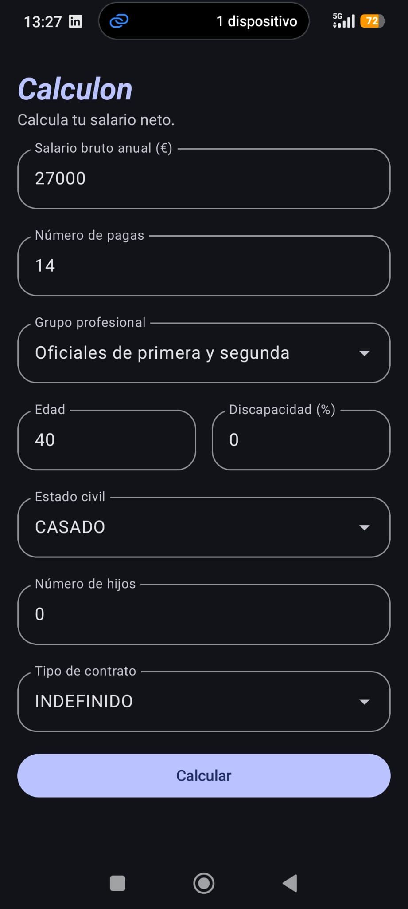
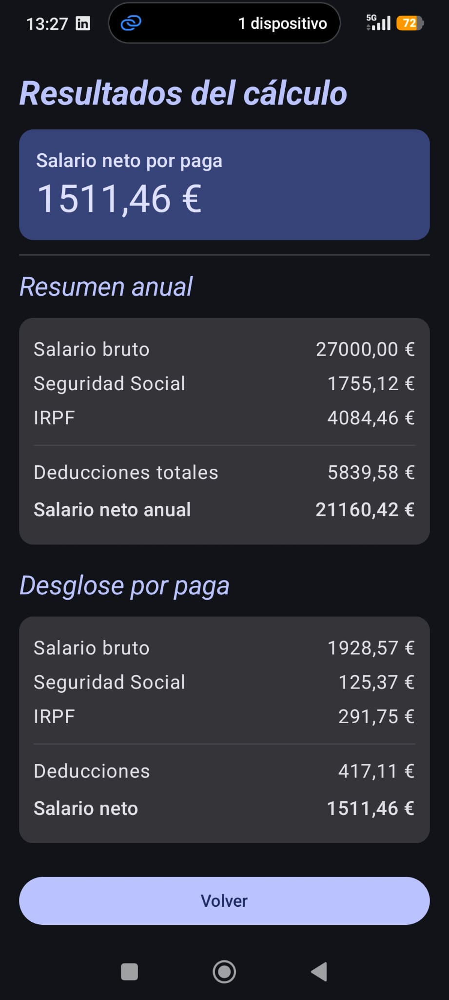

# Calculon 🧮

**Calculon** es una aplicación Android desarrollada en Kotlin que permite calcular de forma orientativa el salario neto a partir de los datos laborales y personales introducidos por el usuario.

El proyecto se ha realizado como actividad formativa del ciclo de Desarrollo de Aplicaciones Multiplataforma (DAM).

## 📱 Capturas de pantalla

### Pantalla de carga


### Formulario de datos


### Resultados del cálculo


## ✨ Funcionalidades

La aplicación permite introducir los siguientes datos:

- Salario bruto anual.
- Número de pagas.
- Grupo profesional.
- Edad.
- Grado de discapacidad.
- Estado civil.
- Número de hijos.
- Tipo de contrato.

A partir de estos datos, Calculon muestra:

- Salario bruto.
- Salario neto.
- Retención estimada de IRPF.
- Cotizaciones a la Seguridad Social.
- Deducciones aplicadas.
- Desglose de importes por paga.

También incorpora validación de los datos introducidos para evitar valores incorrectos.

## 🛠️ Tecnologías utilizadas

- **Lenguaje:** Kotlin.
- **Entorno de desarrollo:** Android Studio.
- **Interfaz gráfica:** Jetpack Compose.
- **Diseño:** Material Design 3.
- **Control de versiones:** Git y GitHub.

## 🧮 Funcionamiento de los cálculos

La aplicación utiliza una simulación simplificada de las retenciones de IRPF y las cotizaciones a la Seguridad Social, teniendo en cuenta los parámetros introducidos por el usuario.

Los resultados tienen carácter orientativo y didáctico. No sustituyen a un cálculo fiscal oficial ni a una nómina real.

## 🚀 Instalación y ejecución

1. Clonar el repositorio:

   ```bash
   git clone https://github.com/David-Sanjo/Calculon.git
   ```

2. Abrir Android Studio.
3. Seleccionar **Open** y elegir la carpeta del proyecto.
4. Esperar a que Gradle sincronice las dependencias.
5. Ejecutar la aplicación en un emulador o dispositivo Android.

## 📂 Estructura del proyecto

```text
Calculon/
├── app/
│   └── src/
│       └── main/
│           ├── java/
│           └── res/
├── gradle/
├── .gitignore
├── build.gradle.kts
├── gradle.properties
├── gradlew
├── gradlew.bat
└── settings.gradle.kts
```

## 👨‍💻 Autor

**David San José**

Proyecto académico desarrollado para el ciclo formativo de Desarrollo de Aplicaciones Multiplataforma (DAM).
